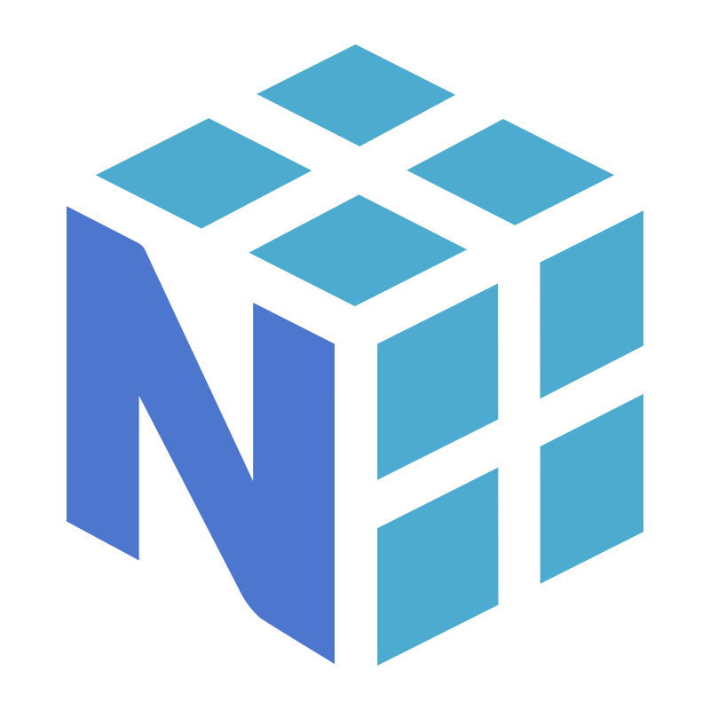
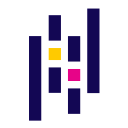

<!-- Header banner -->

<!-- Animated typing line -->

  

<!-- Contact: original logos -->
<table>
  <tr>
    <td align="center" width="110">
      <a href="mailto:alisamanian75@gmail.com">
         <b>Email</b>
      </a>
    </td>
    <td align="center" width="110">
      <a href="https://www.linkedin.com/in/alisamanian/">
         <b>LinkedIn</b>
      </a>
    </td>
    <td align="center" width="110">
      <a href="https://github.com/AliSamanian">
         <b>GitHub</b>
      </a>
    </td>
  </tr>
</table>

📍 Tehran, Iran &nbsp;·&nbsp; <a href="https://ut.ac.ir/en">University of Tehran</a>

 

---

## 👋 About

I am a Computer Engineering graduate from the **University of Tehran**, with a background in software development and research experience in **Machine Learning**, **Computer Vision**, and **AI-assisted learning**. I enjoy exploring technical problems, building practical systems, and applying computational methods across different domains.

 

## 🔬 Research interests

| 🤖 | 👁️ | 🧠 | 🧬 | ⚙️ |
|:---:|:---:|:---:|:---:|:---:|
| **Machine Learning & AI** | **Computer Vision & Image Processing** | **Intelligent Systems** | **Bioinformatics** | **Software Engineering** |

 

## 🚀 Selected work

<table>
  <tr>
    <td width="50%" valign="top">
      <h3>🕸️ Rebeca Dependence Graph Extraction</h3>
      Developed a Java AST visitor to extract control, data, and activation dependencies from Rebeca models.
        
      
    </td>
    <td width="50%" valign="top">
      <h3>🌐 Distributed Systems</h3>
      Implemented MapReduce components and the Raft consensus algorithm.
        
      
    </td>
  </tr>
  <tr>
    <td width="50%" valign="top">
      <h3>📷 Computer Vision Projects</h3>
      Image-processing filters and introductory face-recognition and age-prediction projects.
        
      
      
    </td>
    <td width="50%" valign="top">
      <h3>🏠 AI Projects</h3>
      Built a house-price prediction model and completed machine-learning and neural-network coursework projects.
        
      
      
    </td>
  </tr>
  <tr>
    <td width="50%" valign="top">
      <h3>🔌 Socket Servers</h3>
      Implemented FTP, web, and chat servers using socket programming.
        
      
    </td>
    <td width="50%" valign="top">
      <h3>🌱 Smart Irrigation System</h3>
      Embedded irrigation prototype using sensors, actuators, and I²C communication.
        
      
      
    </td>
  </tr>
</table>

 

## 🎓 Research experience

> **Research Intern — E-Learning Research, University of Tehran**
> - Explored applications of Large Language Models (LLMs) in e-learning.
> - Reviewed approaches for using LLMs to support and enhance learning processes.

 

## 🛠️ Technical toolkit

### Programming languages

<table>
  <tr>
    <td align="center" width="110"> <b>Python</b></td>
    <td align="center" width="110"> <b>C</b></td>
    <td align="center" width="110"> <b>C++</b></td>
    <td align="center" width="110"> <b>Java</b></td>
    <td align="center" width="110"> <b>Go</b></td>
    <td align="center" width="110"> <b>MATLAB</b></td>
    <td align="center" width="110"> <b>Verilog HDL</b></td>
  </tr>
</table>

### Machine learning & computer vision

<table>
  <tr>
    <td align="center" width="110"> <b>PyTorch</b></td>
    <td align="center" width="110"> <b>TensorFlow</b></td>
    <td align="center" width="110"> <b>Keras</b></td>
    <td align="center" width="110"> <b>scikit-learn</b></td>
    <td align="center" width="110"> <b>NumPy</b></td>
    <td align="center" width="110"> <b>Pandas</b></td>
    <td align="center" width="110"> <b>OpenCV</b></td>
  </tr>
</table>

### Tools & software engineering

<table>
  <tr>
    <td align="center" width="110"> <b>Git</b></td>
    <td align="center" width="110"> <b>Spring Boot</b></td>
    <td align="center" width="110"> <b>LaTeX</b></td>
    <td align="center" width="110"> <b>Arduino</b></td>
    <td align="center" width="110"> <b>Linux</b></td>
  </tr>
</table>

 

## 📊 GitHub activity

  

 

## 🎓 Education & languages

- **B.Sc. in Computer Engineering** — University of Tehran, Tehran, Iran (2021–2026)
- 🗣️ **Persian:** Native · **English:** Advanced proficiency

 

*Always learning, building, and exploring.*

