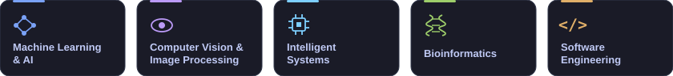
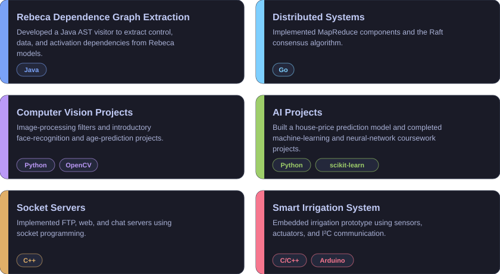

<!-- Header banner -->

<!-- Animated typing line -->

 

<!-- Contact: logos only -->

&nbsp;&nbsp;&nbsp;

&nbsp;&nbsp;&nbsp;

&nbsp;&nbsp;&nbsp;

<!--   -->

<!-- 📍 Tehran, Iran &nbsp;·&nbsp; <a href="https://ut.ac.ir/en">University of Tehran</a> -->

 

<!--  -->

## 👋 About

I am a Computer Engineering graduate from the **University of Tehran**, with a background in software development and research experience in **Machine Learning**, **Computer Vision**, and **AI-assisted learning**. I enjoy exploring technical problems, building practical systems, and applying computational methods across different domains.

 

## 🔬 Research interests

  

 

## 🚀 Selected work

  

 

## 🎓 Research experience

> **Research Intern — E-Learning Research, University of Tehran**
> - Explored applications of Large Language Models (LLMs) in e-learning.
> - Reviewed approaches for using LLMs to support and enhance learning processes.

 

## 🛠️ Technical toolkit

### Programming languages

### Machine learning & computer vision

### Tools & software engineering

 

## 📊 GitHub activity

  

 

## 🎓 Education & languages

- **B.Sc. in Computer Engineering** — University of Tehran, Tehran, Iran (2021–2026)
- 🗣️ **Persian:** Native · **English:** Advanced proficiency

 

*Always learning, building, and exploring.*

